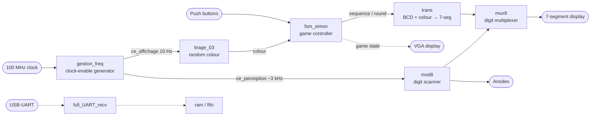
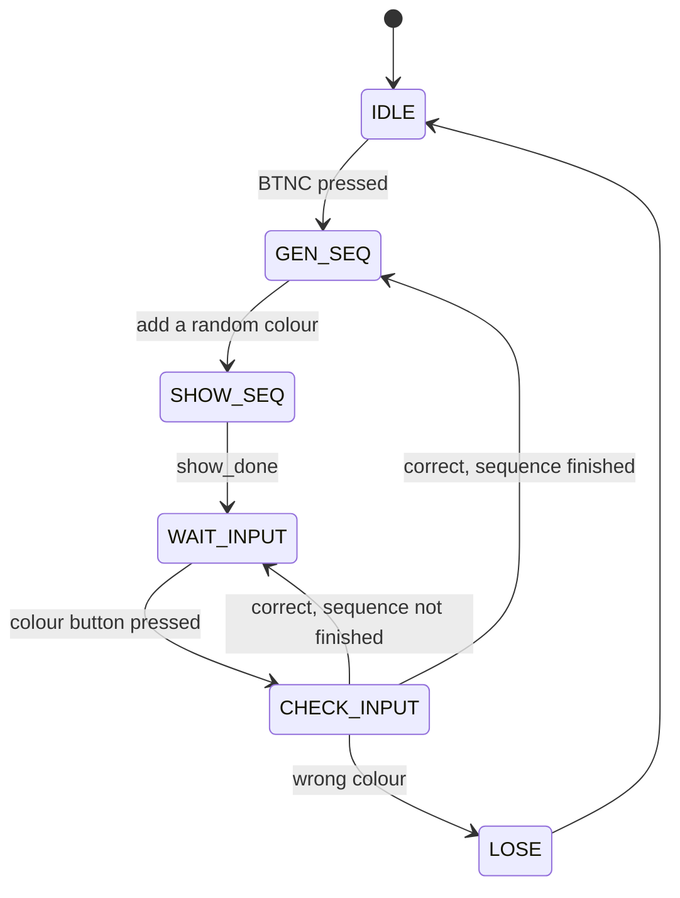

# Simon Game on FPGA (VHDL)

A hardware implementation of the classic memory game **Simon** written in VHDL for the
**Digilent Nexys A7-100T** board (Xilinx Artix-7 `xc7a100tcsg324-1`), with a VGA screen as
the target display.

> Academic project — 2nd year of engineering school (Electronics / Embedded Systems),
> **ENSEIRB-MATMECA**, Bordeaux INP, France — 2025.

---

## The game

Simon shows a sequence of colours, and the player has to repeat it.
Every time the player gets the whole sequence right, the game adds one random colour
to it. One wrong move and the game is over.

| Board input           | Role                                        |
|-----------------------|---------------------------------------------|
| `BTNC` (centre)       | Start a new game                            |
| `BTNR` / `BTNU` / `BTNL` / `BTND` | Pick one of the 4 colours (encoded `00` / `01` / `10` / `11`) |
| `reset` (active high) | Global reset                                |
| 7-segment display     | Round counter and the current colour (debug view) |
| VGA output            | Main game display (coloured tiles)          |

## What this project shows

- **RTL design in VHDL**: synchronous design, finite state machines, counters,
  multiplexers, memories, packages.
- **One clock domain**: everything runs on the 100 MHz board clock. Slower rates come
  from *clock-enable* pulses, not from derived clocks.
- **Modular, reusable blocks**: each function (frequency divider, display driver,
  random draw, UART receiver, RAM/FIFO) is its own entity and can be tested alone.
- **Interfacing with board peripherals**: push buttons, multiplexed 7-segment
  display, UART, VGA.
- **Xilinx Vivado flow** on a real Artix-7 target.

## System overview



Dotted lines are interfaces that are planned but not yet in this repository (see
[Project status](#project-status)).

### Game controller state machine



For the reasoning behind each design choice, see
**[docs/ARCHITECTURE.md](docs/ARCHITECTURE.md)**.

## Repository layout

```
.
├── src/
│   ├── pkg/        simon_pkg.vhd          shared types (sequence array)
│   ├── game/       fsm_simon.vhd          main game state machine (top level)
│   │               tirage_03.vhd          random colour draw (modulo-4 counter)
│   │               input_reader.vhd       buttons → 2-bit colour code
│   │               compare_input.vhd      player input vs. expected colour
│   ├── display/    trans_simon.vhd        binary → 7-segment / colour symbols
│   │               mod_8_simon.vhd        digit scan counter + anode decoder
│   │               mux_7_segments.vhd     8 → 1 segment multiplexer
│   ├── clocking/   gestion_freq.vhd       clock-enable generator
│   ├── memory/     ram.vhd                64 × 2-bit synchronous RAM
│   │               fifo.vhd               generic synchronous FIFO
│   └── uart/       uart_recv.vhd          UART RX (115 200 baud) — course IP
│                   full_uart_recv.vhd     UART → memory write chain
│                   merger_8b_to_16b.vhd   byte merger
│                   stop_counter.vhd       saturating address counter
├── scripts/
│   └── create_project.tcl                 rebuilds the Vivado project
└── docs/
    └── ARCHITECTURE.md                    design choices explained
```

## Building

Requirements: **Xilinx Vivado** (the project was created with 2022.2) and a Nexys A7-100T board.

```bash
# Generate the Vivado project in ./build (not tracked by git)
vivado -mode batch -source scripts/create_project.tcl

# Then open it in the GUI
vivado build/simon_fpga.xpr
```

Quick syntax check without Vivado, using [GHDL](https://github.com/ghdl/ghdl):

```bash
mkdir -p build/ghdl
ghdl -a --std=93c --workdir=build/ghdl src/pkg/*.vhd src/clocking/*.vhd src/game/fsm_simon.vhd
```

## Project status

This repository holds the sources of the project as they were when the lab sessions
ended. It is an **unfinished snapshot**, not a finished product:

| Part | Status |
|---|---|
| Game FSM, clock enables, 7-segment chain, RAM, FIFO, UART RX core | Written |
| Pin constraints (`.xdc`) and board top-level entity | Not in this repository |
| VGA controller | Not in this repository |
| Testbenches | Not in this repository |
| `tirage_03`, `trans_simon`, `full_uart_recv` | Have analysis errors that still need fixing |

Known limitations and next steps are listed in
[docs/ARCHITECTURE.md](docs/ARCHITECTURE.md#known-limitations--next-steps).

## Credits

- `uart_recv.vhd` and `full_uart_recv.vhd`: UART receiver by **Yannick Bornat**,
  provided by ENSEIRB-MATMECA for lab sessions (original header kept).
- `fifo.vhd`: based on the open-source synchronous FIFO example from Nandland.
- Everything else: written during the project.

## Author

**Marcel Szerszen** — engineering student, ENSEIRB-MATMECA (Bordeaux, France)
GitHub: [@platinik](https://github.com/platinik)
