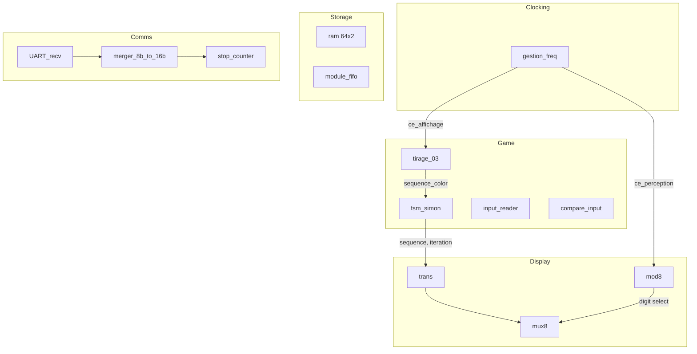

# Architecture & Design Choices

This document explains how the Simon FPGA design is split into blocks, and why each
of the main design decisions was made. The target is a Digilent **Nexys A7-100T**
(Artix-7 `xc7a100tcsg324-1`) with a single 100 MHz oscillator.

---

## 1. Design principles

| Principle | How it is applied | Why |
|---|---|---|
| **Fully synchronous, one clock** | Every register uses `rising_edge(clk)` on the 100 MHz board clock. | No clock domain crossings, no timing issues from clock skew, and easy static timing analysis in Vivado. |
| **Clock enables, not derived clocks** | `gestion_freq` makes one-cycle `ce_*` pulses instead of dividing the clock. | Clocks made from logic go through general routing instead of the global clock tree (BUFG). That adds skew and makes timing hard to close. A clock enable keeps a single clock net. |
| **One function per entity** | Divider, scanner, mux, decoder, random draw, FSM, memories, UART are all separate entities. | Each block can be simulated and checked alone, reused in other projects, and replaced without touching the rest. |
| **Small data encoding** | A colour is a 2-bit code (`00`–`11`). | 4 colours fit exactly in 2 bits. This keeps the sequence storage and the comparators as small as possible. |
| **Separate control and datapath** | `fsm_simon` only decides *what happens next*. Counters, memories and decoders do the work. | This is the classic controller/datapath split. The FSM stays readable and the datapath blocks stay generic. |

---

## 2. Block decomposition



### 2.1 Clock-enable generator — `src/clocking/gestion_freq.vhd`

Two free-running counters on the 100 MHz clock:

| Output | Divider | Rate | Used for |
|---|---|---|---|
| `ce_affichage` | 10 000 000 | **10 Hz** | Game-speed events (sequence playback, random draw) |
| `ce_perception` | 33 334 | **≈ 3 kHz** | 7-segment scanning (≈ 375 Hz per digit over 8 digits, well above flicker) |

**Why:** one block creates every slow time base, so all timing constants are in one
place. The scan rate is chosen so each digit refreshes much faster than the eye can
see (> 60 Hz), but slowly enough for the segment LEDs to switch fully.

### 2.2 Game controller — `src/game/fsm_simon.vhd`

A **two-process FSM**: one clocked process holds the state register, and one
combinational process computes the next state and the outputs.

States: `IDLE → GEN_SEQ → SHOW_SEQ → WAIT_INPUT → CHECK_INPUT → (GEN_SEQ | WAIT_INPUT | LOSE)`.

**Why a two-process FSM:**
- The next-state logic can be read directly as the state diagram.
- Outputs get default values at the top of the process (`seq_add_color <= '0'`, …),
  so every output is assigned on every path. This is the standard way to avoid
  unwanted latches on control outputs.
- Control signals (`seq_add_color`, `show_start`, `reset_show`, `reset_input`,
  `input_next`, `lose_flag`) are single-cycle **strobes** sent to the datapath blocks.
  This decouples the FSM from how those blocks are built.

**Why the sequence is a flat 128-bit vector (`64 × 2 bits`):**
- Every element can be read at once, with no memory read latency. The check
  `player_colour = sequence(i)` is then a simple combinational comparison inside
  `CHECK_INPUT`.
- At 128 bits, the storage fits easily in flip-flops (the Artix-7 100T has over 126 000).
- A memory-based version is also available (`ram.vhd`, see §2.6) for when the
  sequence gets longer or a fixed read latency is acceptable.

**Button priority:** in `WAIT_INPUT` the buttons are checked in a fixed order
(RIGHT > UP > LEFT > DOWN), so pressing two at once still gives a single,
predictable result.

### 2.3 Random colour draw — `src/game/tirage_03.vhd`

A **modulo-4 counter** that keeps running and is read when the FSM asks for a new
colour (`add_color`).

**Why not an LFSR?** The randomness comes from the **player's timing**. The counter
cycles through all 4 values much faster than anyone can control a button press, so
the value read at the moment of a press is effectively unpredictable. This takes only
2 flip-flops and spreads the colours evenly. An LFSR would only make sense for a
reproducible or demo mode.

### 2.4 Input path — `src/game/input_reader.vhd`, `src/game/compare_input.vhd`

- `input_reader` converts the 4 direction buttons into a `(player_pressed, player_color)`
  pair. Only a *one-hot* button vector counts as a valid press, so pressing two
  buttons at once is ignored.
- `compare_input` is a registered comparator. It outputs one-cycle `good_step` / `error`
  pulses.

**Why separate blocks:** these two blocks are an alternative to doing the decoding and
comparison inside the FSM. Splitting them out lets the FSM work only with events
("good step", "error") and not with raw button levels.
Button debouncing/edge detection (`Reg_B_*` registers) came from an earlier lab project
and is not included in this repository.

### 2.5 7-segment display chain — `src/display/`

```
nb_binaire ─► trans (binary→BCD→segments) ─┐
                                          ├─► mux8 ─► CA..CG
mod8 (scan counter) ───── select ─────────┘
mod8 ──────────────────── AN[7:0] (one active-low anode)
```

- **Time multiplexing:** the Nexys A7 display has 8 digits but only one shared set of
  segment lines, so the digits have to be scanned. `mod8` counts on `ce_perception`
  and turns on one anode at a time. `mux8` sends the matching segment pattern.
- **`trans`** converts the round counter (6-bit binary) into tens/units digits and
  shows the current colour as a **directional glyph**: right bar, top bar, left bar,
  bottom bar for RIGHT/UP/LEFT/DOWN. This gives a debug view of the game without the VGA screen.
- The decimal point marks digit 0 as a visual reference.

**Why three entities:** counter, multiplexer and decoder are all generic. The same
`mod8` + `mux8` pair can drive any 8-digit content without changes.

### 2.6 Memories — `src/memory/`

- **`ram.vhd`**: 64 × 2-bit memory with a synchronous read and a separate read
  address and write address. It is written in the template style that Vivado
  recognises as distributed or block RAM. It can replace the flat vector when the
  sequence gets longer.
- **`fifo.vhd`**: a generic synchronous FIFO (`g_WIDTH`, `g_DEPTH`). It can buffer data
  between the UART receiver and the game logic, which produce and consume data at
  different rates.

### 2.7 UART reception — `src/uart/`

`UART_recv` (course IP, 115 200 baud at 100 MHz) checks each bit over a quarter of a
bit period before accepting it. This makes it tolerant to noise on the line.
`full_UART_recv` chains it with a byte merger and a saturating address counter
(`stop_counter`) to write the received data straight into memory.

**Intended use:** loading sequences or settings from a PC over the board's USB-UART
bridge, which gives a test path without re-synthesis.

### 2.8 VGA display (planned)

The intended main display is a VGA output (Nexys A7: 12-bit RGB on the VGA connector).
The natural design is a standard 640×480 @ 60 Hz timing generator (25 MHz pixel rate
made with a clock enable from the 100 MHz clock, following §1) and a renderer that
draws 4 coloured tiles. The active tile brightens while the sequence plays and on each
player press. The VGA sources are not part of this repository.

---

## 3. Known limitations & next steps

This snapshot is a work in progress. Its limits are listed openly here:

1. **Registers assigned in the combinational FSM process.** `s_sequence`,
   `s_iteration` and `curr_seq_index` are updated in the combinational process of
   `fsm_simon`, which infers latches and, for `s_iteration + 1`, a combinational loop.
   *Fix:* move these counters and the sequence register into the clocked process
   (or into separate datapath registers controlled by the FSM strobes).
2. **Analysis errors** in three files (found with GHDL, VHDL-93):
   - `tirage_03.vhd`: reset value `"0"` is assigned to a 2-bit signal (should be `"00"`).
   - `trans_simon.vhd`: `case` on a slice with a variable index is not allowed in
     VHDL-93. *Fix:* copy the slice into a variable first, and add `iteration` to the
     sensitivity list.
   - `full_uart_recv.vhd` / `merger_8b_to_16b.vhd`: the merger output (2-bit) does not
     match the 16-bit data path.
3. **Asynchronous reset in `gestion_freq`** is written outside the `if/elsif rising_edge`
   structure. It should use the standard `if raz = '1' … elsif rising_edge(…)` template.
4. **Missing parts**: board top-level entity, `.xdc` pin constraints, VGA controller,
   button debouncers and testbenches.
5. **Sequence length**: `simon_pkg.seq_array` holds 32 entries, while the flat vector
   in `fsm_simon` holds 64. These limits should come from a single constant in the package.

### Suggested verification plan

- Unit testbenches for `gestion_freq` (pulse period), `mod8` (anode rotation),
  `tirage_03` (uniform coverage), `input_reader` (one-hot only).
- A self-checking FSM testbench that plays a full game: correct sequence → round++,
  wrong colour → `LOSE`.
- Run them with GHDL in CI (GitHub Actions) so every push is checked automatically.
